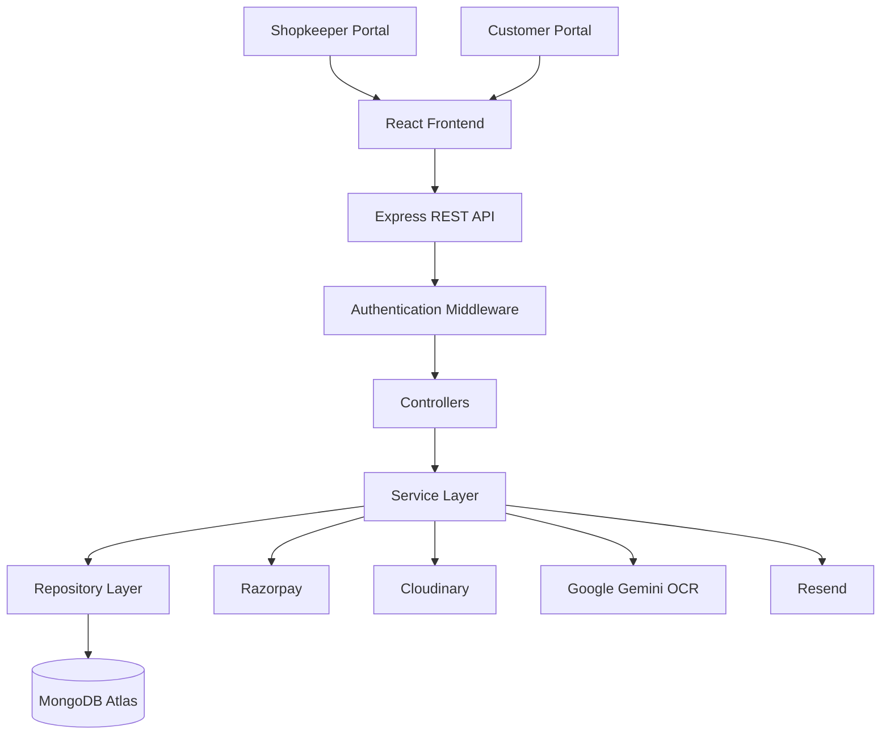

# BillNest — Smart Billing & Warranty Management System

<p align="center">
  <b>A modern full-stack billing, inventory, invoice, and warranty management platform.</b>
</p>

<p align="center">
  <a href="https://bill-nest-production.vercel.app/">Live Demo</a> •
  <a href="https://github.com/itsmeetsharma777/BillNest-Production">GitHub Repository</a>
</p>

---

## 📌 Overview

**BillNest** is a full-stack web application designed to simplify billing, invoice management, inventory tracking, customer management, and warranty handling for shopkeepers and businesses.

The platform provides separate portals for shopkeepers and customers, enabling efficient business operations, transparent customer records, online payments, and AI-powered invoice data extraction.

BillNest aims to replace traditional manual billing processes with a centralized, secure, and user-friendly digital solution.

## ✨ Features

### 🧾 Smart Invoice Management
- Create and manage professional invoices.
- Generate downloadable invoice PDFs.
- Print invoices directly.
- Support for partial and full payments.
- Track paid, unpaid, and outstanding amounts.
- Invoice cancellation and management.

### 📦 Inventory Management
- Product and category management.
- Product variants and brand management.
- Stock tracking and adjustments.
- Inventory movement history.
- Stock restoration during applicable invoice cancellations.

### 👥 Customer Management
- Customer profile management.
- Customer account and payment ledger.
- Customer invoice history.
- Phone-number-based customer identification.
- Customer portal access.

### 🛡️ Warranty Management
- Create and manage warranty records.
- Associate warranties with invoices and customers.
- Warranty expiry tracking.
- Digital warranty cards.
- QR-code-based warranty verification.
- Public warranty verification functionality.

### 💳 Payment Integration
- Razorpay payment gateway integration.
- Online payment support.
- Cash and cheque payment methods.
- Partial payment tracking.
- Outstanding balance calculation.

### 🤖 AI-Powered OCR
- Upload invoice and bill images.
- Extract invoice information using AI.
- Automated extraction of customer details, dates, products, and totals.
- Review and edit extracted data.
- Customer-side bill upload functionality.
- AI-assisted bill understanding.

### 📊 Dashboard & Reports
- Business dashboard.
- Invoice summaries.
- Sales reports.
- GST-related reports.
- Customer and inventory insights.

### 🔐 Authentication & Security
- Role-based authentication.
- Shopkeeper and customer portals.
- Secure session management.
- CSRF protection.
- API rate limiting.
- Input validation using Zod.
- Protected routes and authorization middleware.

### 🎨 Modern UI/UX
- Responsive interface.
- Dark and light themes.
- Modern dashboard design.
- User-friendly invoice workflows.

---

## 🛠️ Tech Stack

### Frontend
| Technology | Purpose |
|---|---|
| React 19 | UI development |
| TypeScript | Type-safe development |
| Vite | Development server and build tool |
| Tailwind CSS 4 | Styling |
| React Router 7 | Routing |
| TanStack React Query | Server-state management |
| Axios | API communication |
| React Hook Form | Form management |
| Zod | Validation |

### Backend
| Technology | Purpose |
|---|---|
| Node.js | JavaScript runtime |
| Express 5 | REST API framework |
| TypeScript | Backend type safety |
| MongoDB | Database |
| Mongoose 9 | Object Data Modeling |
| Argon2 | Password hashing |
| Zod | Request validation |
| PDFKit | PDF generation |
| Pino | Logging |

### Integrations
| Service | Purpose |
|---|---|
| MongoDB Atlas | Cloud database |
| Razorpay | Online payments |
| Cloudinary | Image and document storage |
| Google Gemini | AI-powered OCR |
| Resend | Email delivery integration |

### Testing & Deployment
- Playwright — End-to-end testing
- Vercel — Frontend deployment
- Render — Backend deployment

---

## 🏗️ System Architecture



---

## 📂 Project Structure

```text
BillNest-Production/
│
├── backend/
│   ├── src/
│   │   ├── config/
│   │   ├── controllers/
│   │   ├── middleware/
│   │   ├── migrations/
│   │   ├── models/
│   │   ├── repositories/
│   │   ├── routes/
│   │   ├── services/
│   │   ├── validators/
│   │   └── server.ts
│   │
│   ├── package.json
│   └── tsconfig.json
│
├── frontend/
│   ├── src/
│   │   ├── components/
│   │   ├── context/
│   │   ├── layout/
│   │   ├── pages/
│   │   │   ├── customer/
│   │   │   └── shopkeeper/
│   │   ├── router/
│   │   ├── lib/
│   │   └── utils/
│   │
│   ├── package.json
│   └── vite.config.ts
│
└── README.md
```

---

## 🚀 Installation & Setup

### Prerequisites

- Node.js
- npm
- MongoDB Atlas account or local MongoDB
- Razorpay account for payment testing
- Gemini API key for OCR functionality

### 1. Clone the Repository

```bash
git clone https://github.com/itsmeetsharma777/BillNest-Production.git

cd BillNest-Production
```

### 2. Backend Setup

```bash
cd backend

npm install
```

Create a `.env` file inside the backend directory.

```env
NODE_ENV=development
PORT=5000

MONGODB_URI=your_mongodb_connection_string

SESSION_SECRET=your_secure_session_secret

FRONTEND_URL=http://localhost:5173

RAZORPAY_KEY_ID=your_razorpay_key_id
RAZORPAY_KEY_SECRET=your_razorpay_key_secret

GEMINI_API_KEY=your_gemini_api_key
GEMINI_OCR_MODEL=gemini-3.5-flash-lite

CLOUDINARY_CLOUD_NAME=your_cloudinary_name
CLOUDINARY_API_KEY=your_cloudinary_api_key
CLOUDINARY_API_SECRET=your_cloudinary_api_secret

RESEND_API_KEY=your_resend_api_key
EMAIL_FROM=your_verified_sender_email
```

Start the backend:

```bash
npm run dev
```

### 3. Frontend Setup

Open another terminal:

```bash
cd frontend

npm install

npm run dev
```

Open the application:

```text
http://localhost:5173
```

---

## 🧪 Testing

BillNest uses Playwright for end-to-end testing.

Example commands:

```bash
npm run test
```

```bash
npx playwright test
```

Testing focuses on:

- Authentication and authorization.
- Shopkeeper dashboard.
- Customer portal.
- Invoice creation and management.
- Inventory management.
- Warranty functionality.
- Payment workflows.
- OCR functionality.

Refer to the testing repository for the complete test suite:

[BillNest Playwright Repository](https://github.com/itsmeetsharma777/BillNest-Playwright)

---

## 🌐 Live Deployment

| Component | Deployment |
|---|---|
| Frontend | [BillNest Live Application](https://bill-nest-production.vercel.app/) |
| Backend | Render |
| Database | MongoDB Atlas |

---

## 📚 Documentation

BillNest includes a dedicated development documentation suite covering:

- Software Requirements Specification (SRS)
- System Architecture
- Database Design
- API Documentation
- Development Workflows
- Security & Privacy
- Testing Strategy
- Deployment Guide
- Developer Onboarding
- Glossary & Viva Reference

📖 Documentation Package:

[Download BillNest Development Documentation](https://github.com/itsmeetsharma777/BillNest-Production)

---

## 🔮 Future Enhancements

- Subscription-based plans.
- Multi-user staff management.
- Advanced audit logs.
- WhatsApp and SMS notifications.
- Advanced analytics.
- Automated backup and recovery.
- Enhanced AI-powered invoice analysis.
- Improved accessibility and performance.

---

## 👨‍💻 Developer

**Meet Sharma**

Computer Science Engineering Student

- GitHub: [@itsmeetsharma777](https://github.com/itsmeetsharma777)
- Project: [BillNest](https://github.com/itsmeetsharma777/BillNest-Production)

---

## 📄 License

This project is developed for educational and development purposes.

A formal open-source license should be added before permitting public reuse or redistribution.

---

<p align="center">
  <b>BillNest — Simplifying Billing. Managing Business. Empowering Customers.</b>
</p>
