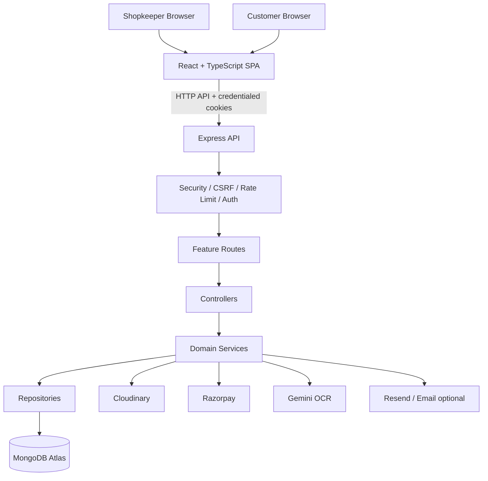

# Architecture and System Design
## 1. Architectural style
BillNest uses a modular monolith backend and a single-page React frontend. Domain concerns are separated by routes, controllers, services, repositories, Mongoose models, validators, and middleware. This structure supports independent feature modules while keeping one deployable API process.

## 2. Logical architecture

## 3. Frontend composition
- Entry point: `frontend/src/main.tsx`.
- Router: `frontend/src/router/index.tsx`.
- Public/protected route definitions: `public-routes.tsx`, `protected-routes.tsx`.
- Session state: `context/AuthContext.tsx`; `/api/auth/me` is fetched with `credentials: include`.
- Theme state: `context/theme-context.tsx`.
- UI primitives under `components/ui`; layouts under `components/layout`.
- Shopkeeper and customer pages are separate route groups.

## 4. Backend request lifecycle
1. `backend/src/server.ts` loads dotenv and configuration.
2. Express trusts one proxy hop (hosting proxy context).
3. Helmet headers and CORS are applied.
4. JSON and URL-encoded body limits are applied.
5. Cookie parser runs.
6. CSRF middleware runs before application routes.
7. General rate limiter applies (200 requests per 15-minute window in server source).
8. `/health` exposes an unauthenticated health endpoint.
9. Feature routers are mounted under `/api/...`.
10. Global error middleware handles route errors.
11. Database connects before server starts; product SKU/barcode indexes are normalized/ensured.
12. Warranty notification scheduler starts at boot and repeats hourly.

## 5. Module boundary / route mounts
| Mount | Domain |
|---|---|
| `/api/auth` | authentication and password reset |
| `/api/shops` | shop |
| `/api/customers` | shopkeeper customer management |
| `/api/products` | products |
| `/api/product-variants` | variants |
| `/api/product-catalog` | catalog |
| `/api/categories` | categories |
| `/api/brands` | brands |
| `/api/invoices` | invoices |
| `/api/warranties` | warranty management |
| `/api/reports` | reports |
| `/api/dashboard` | dashboard |
| `/api/documents` | document management |
| `/api/ocr` | OCR/AI document extraction |
| `/api/customer/bills` | customer bills |
| `/api/notifications` | shopkeeper notifications |
| `/api/inventory` | inventory |
| `/api/customer` | customer portal |
| `/api/public` | public warranty verification |
| `/api/customer/account` | customer account |
| `/api/customer/notifications` | customer notifications |

## 6. Design considerations
- Authentication is cookie/session-based, not documented as localStorage bearer token.
- Domain ownership checks are crucial: user -> shop -> records; customer portal must ensure the signed-in customer can only read their own data.
- Financial and inventory effects should be treated as one business operation; define idempotency for payment callbacks and retries.
- External integrations need timeout, failure, retry, and reconciliation handling.
- Avoid coupling UI page logic to database-specific assumptions; service layer owns domain operations.
