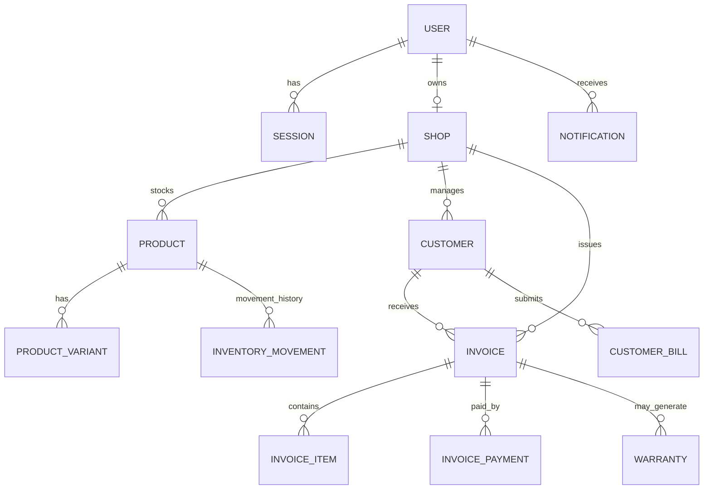

# Domain Model and Data Dictionary
## Core relationship sketch

This is a conceptual diagram; verify exact cardinalities and field references against all schema files.

## Entities (known from repository structure)
- **User**: identity, account status, role, email verification; supports shopkeeper/customer role.
- **Session**: server-side session record; authentication middleware hashes the cookie token and looks up a session.
- **Shop**: shopkeeper's shop identity and configuration.
- **Customer**: customer profile; phone number is a major identifier in prior project requirements.
- **Product**: shop-owned stock/catalog item. SKU and barcode have per-shop partial unique indexes for non-empty strings.
- **ProductVariant**: product variation such as size/attributes and stock/pricing, exact schema needs inspection.
- **Category / Brand**: catalog classification.
- **Invoice**: shopId, customerId, invoiceNumber, issueDate, dueDate, status, paymentMethod, Razorpay order ID, subtotal, discount, tax, CGST/SGST/IGST, total, amountPaid, amountDue.
- **InvoiceItem**: invoice line detail.
- **InvoicePayment**: payment ledger entry associated with invoice.
- **Warranty**: product/customer/invoice warranty data, dates, status, terms; exact fields must be read from warranty schema.
- **InventoryMovement**: stock change audit trail and references; inspect schema for movement types.
- **CustomerBill**: uploaded/reviewed customer bill.
- **Notification**: recipient/type/status/content data.
- **AuditLog**: event history.
- **Document**: uploaded document metadata.
- **Counter**: sequence/counter utility.
- **PasswordResetToken**: password reset lifecycle.

## Invoice invariants to validate
- `total >= 0`; `amountPaid >= 0`; `amountDue >= 0`.
- For normal invoices, amountDue should equal total minus amountPaid (subject to rounding and explicit credits).
- Paid state should reconcile to amountDue = 0.
- Partial state should reconcile to 0 < amountPaid < total.
- Cancelled invoices should not silently retain active stock/payment side effects.
- Invoice number uniqueness scope (global vs per-shop) must be confirmed from schema/service/index.

## Data handling guidance
- Treat email, phone, customer names, invoice contents, uploaded images, and payment references as personal/confidential business data.
- Store provider secrets only in server environment.
- Define retention and deletion policy for documents and customer account data.
- Index query paths used for shopId/customerId/status/date pagination.
