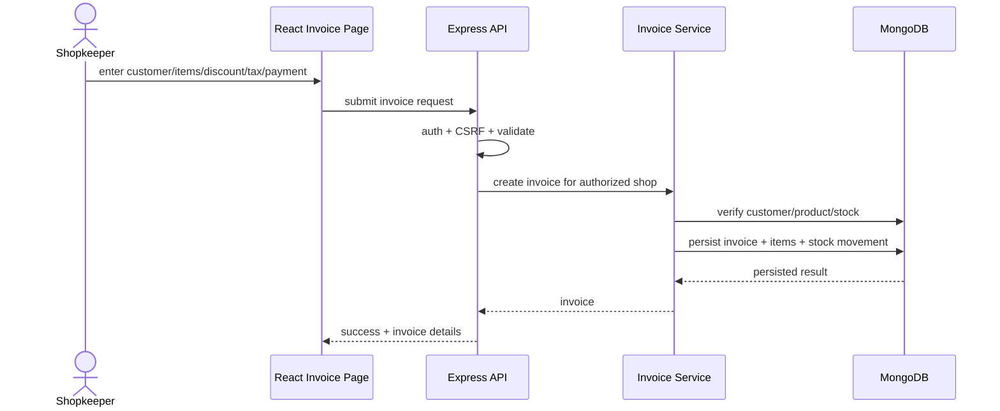

# Workflows and Sequence Descriptions
## A. Session restoration
1. SPA loads and AuthProvider starts loading.
2. Frontend requests `/api/auth/me` with cookies.
3. Auth middleware extracts session cookie and hashes it.
4. Session repository finds session; user repository resolves user.
5. Inactive/missing user or invalid session produces unauthenticated response.
6. Frontend stores user in in-memory context and route guard selects the correct role area.

## B. Shopkeeper invoice creation (conceptual)

Exact transaction and sequence mechanics require service-source verification.

## C. Partial payment
- Record a payment against an invoice.
- Recompute amountPaid and amountDue.
- Set state to partially_paid while a positive balance remains; paid when fully settled.
- Customer portal and shopkeeper ledger should reflect the same reconciled values.
- Test overpayment, repeated submission, rounding, payment failure, and concurrent updates.

## D. Razorpay payment
1. Frontend requests server-created payment/order for a due amount.
2. Provider checkout collects payment.
3. Backend verifies provider response/signature.
4. Backend records payment and reconciles invoice state.
5. Frontend refreshes invoice/account view.
The exact endpoint names and callbacks should be derived from current payment routes; this sequence is a recommended contract, not a claim that every step is implemented exactly this way.

## E. OCR bill import
1. User uploads image/document.
2. Upload middleware validates type/size.
3. Backend sends image to configured Gemini model.
4. Model returns structured extracted fields.
5. Application validates and displays editable review.
6. User confirms; only then create or update financial/business records.
7. Store original document as allowed by retention policy and link extraction provenance.

## F. Warranty lifecycle
- Warranty is created/associated with an invoice/customer/product.
- Warranty detail is visible to authorized shopkeeper and customer.
- Public verification route should expose only intended minimal data.
- Scheduled job checks expiry windows and creates notifications.
- Verify duplicate-notification prevention, timezone handling, and scheduler behavior across multiple replicas.

## G. Customer bill review
Customer portal includes bills and bill review route. Suggested flow: upload bill -> OCR/extraction -> review extracted fields -> customer confirms -> associate to account/merchant or mark independent bill. Check code for actual workflow and access constraints.
